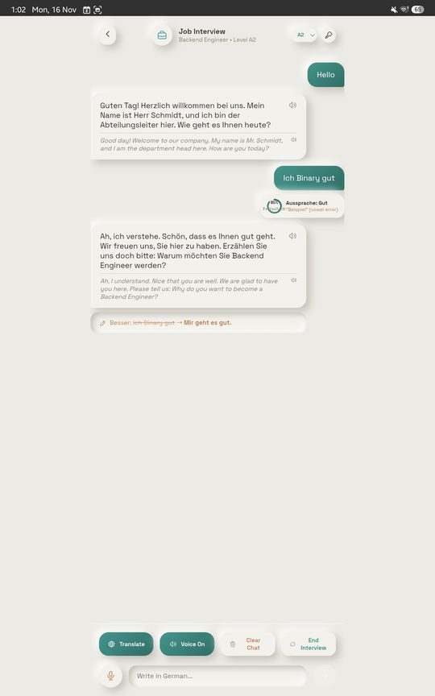
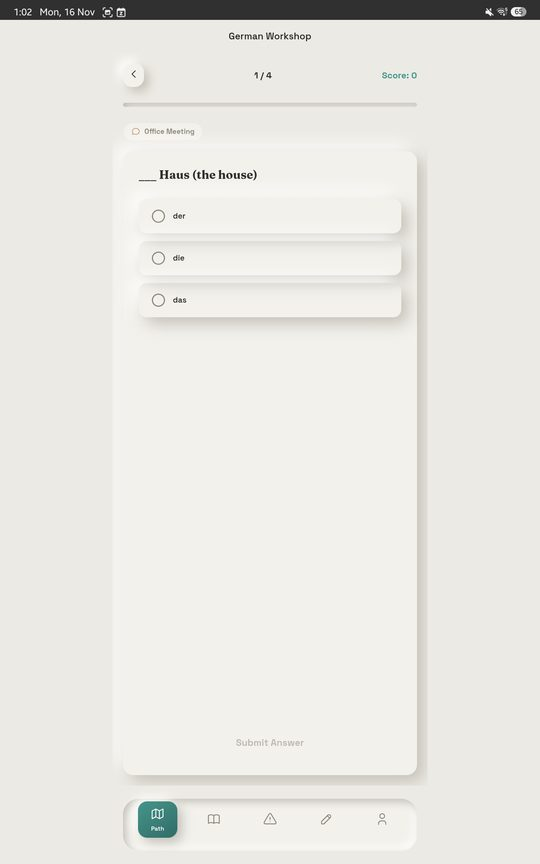
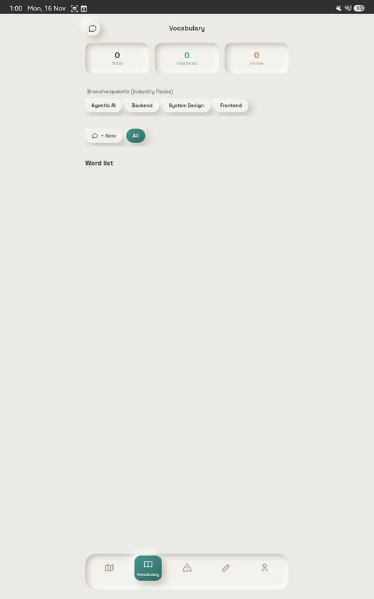
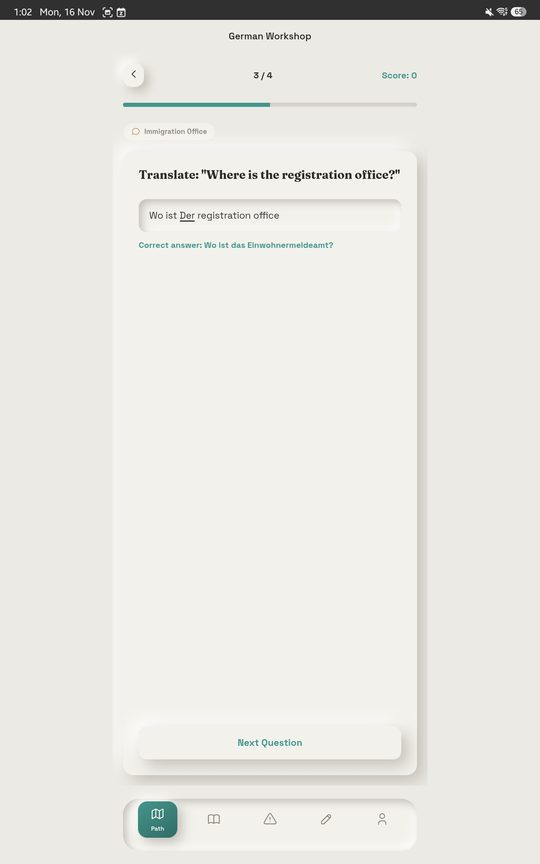
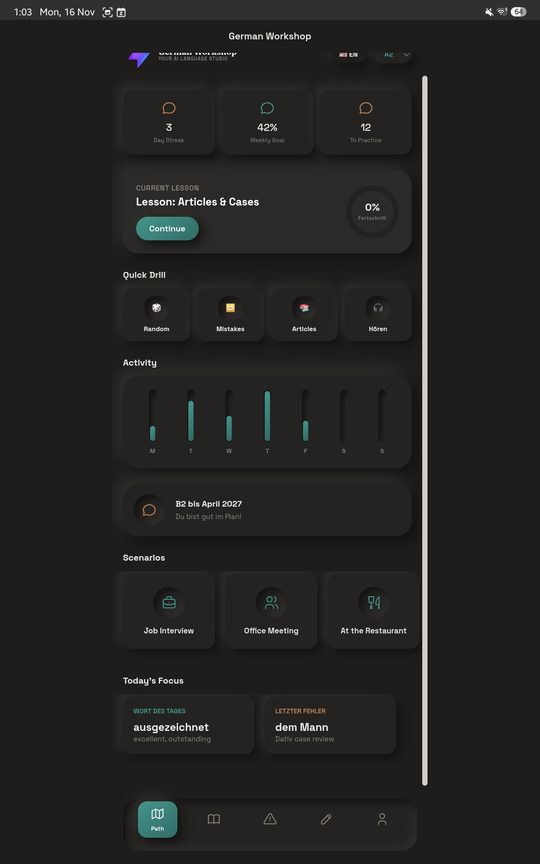
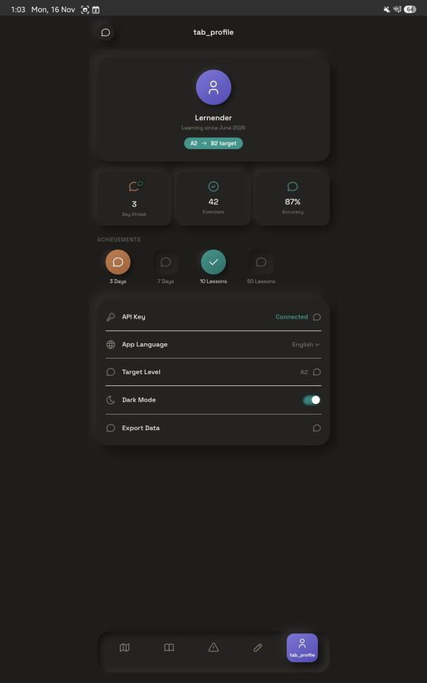

# German Workshop

A personal AI language studio for learning German: daily drills, role-play conversations, vocabulary, and writing practice, all in one soft, teal-and-cream app.

Built for fun while learning German myself. I wanted practice that fits my own situations (job interviews, offices, bureaucracy) instead of generic phrasebook lessons.

<p align="center">
  
  
  
  
  
</p>

<details>
<summary>More screenshots</summary>
<br />
<p align="center">
  
  
  
  
</p>
</details>

## Why I built this

I'm learning German and wanted one place to practice daily, aimed at real situations. It's also a playground for AI features like role-play partners that correct me as I go. A side project with no deadlines, so I tinker whenever I feel like it.

> Hobby project. Things may be rough, and features change whenever I feel like tinkering.

## What's inside

**Path (home)**
- Day streak, weekly goal, and words to practice
- Current lesson card (like "Articles & Cases") with progress
- Quick drills: Random, Mistakes, Articles, Hören (listening)
- Weekly activity chart, a goal tracker, word of the day, and last mistake

**Scenarios: AI role-play**
- Practice conversations: Job Interview, Office Meeting, At the Restaurant
- Pick a topic (for example Backend Engineer) and a level from A1 to C2
- Type or speak in German
- AI replies in German with an English translation underneath
- Corrections under each of your messages ("Besser: ...")
- Pronunciation score with a note on what to fix
- Voice on/off, translate toggle, clear chat, end interview

**Quiz**
- Fill-in-the-article questions (der / die / das)
- Translation exercises with the correct answer shown
- Questions tagged by situation, such as Office Meeting or Immigration Office

**Vocabulary**
- Total, mastered, and due-for-review counts
- Industry packs: Agentic AI, Backend, System Design, Frontend
- Add your own words

**Writing**
- A daily writing task with a history of past entries

**Profile**
- Streak, exercise count, accuracy, and achievements
- Target level, app language, light/dark mode, data export
- Bring your own API key for the AI features

## Run it

```bash
git clone https://github.com/Abhijit-Birle/German-Learning.git
cd German-Learning
npm install
npm run dev
```

Open the Profile tab and add your API key to turn on the AI features.

## What's next (maybe)

More scenarios, spaced repetition for vocabulary, listening drills. No promises.

## Author

**Abhijit Birle** · [GitHub](https://github.com/Abhijit-Birle)
