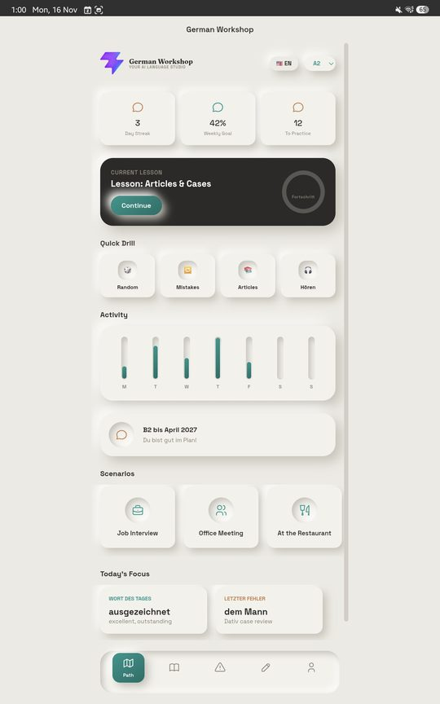
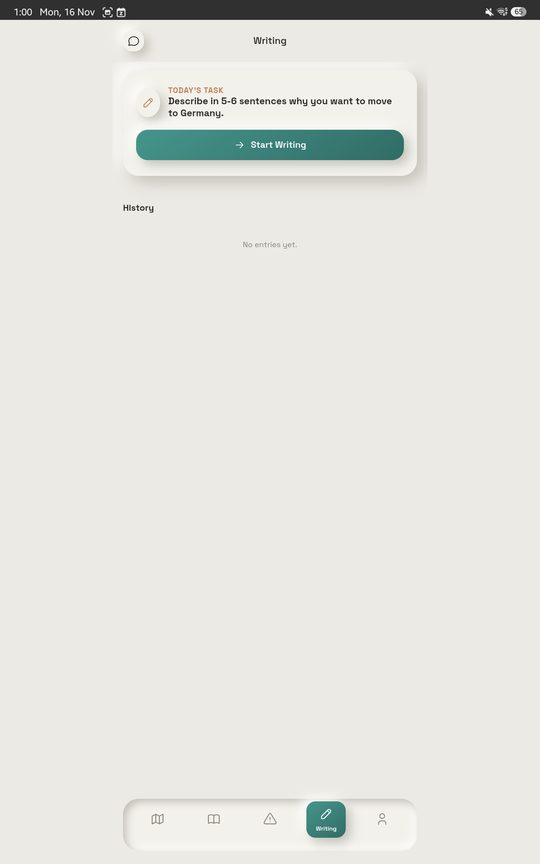
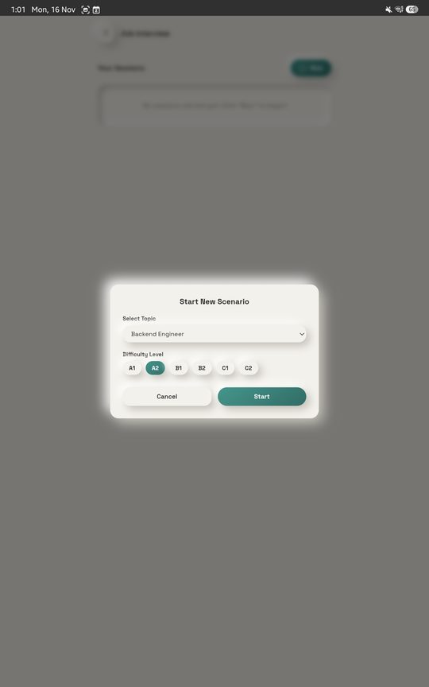

<div align="center">

# 🇩🇪 Deutsch Werkstatt

**AI-powered German practice for tech professionals**

<a href="https://github.com/Abhijit-Birle/deutsch-werkstatt">
  
</a>

<br />


<br />

<p>
  <a href="#-highlights">Highlights</a> ·
  <a href="#-screenshots">Screenshots</a> ·
  <a href="#-everything-inside">Everything inside</a> ·
  <a href="#-run-it">Run it</a>
</p>

</div>

---

## 👋 Why I built this

I'm learning German and wanted daily practice built around **my own situations**: job interviews, office talk, and tech vocabulary. A side project with no deadlines, so it's also a playground for AI features.

> 🛠️ Hobby project. Rough edges included, and it changes whenever I feel like tinkering.

## ✨ Highlights

<table>
  <tr>
    <td width="50%" valign="top">
      <h3>🎭 AI role-play</h3>
      Practice a <b>Job Interview</b>, <b>Office Meeting</b>, or <b>Restaurant</b> chat. Pick a topic like <i>Backend Engineer</i> and any level from A1 to C2. Type or speak.
    </td>
    <td width="50%" valign="top">
      <h3>🛠️ Instant corrections</h3>
      Every message gets a <b>"Besser:"</b> fix, a <b>pronunciation score</b>, and an English translation under each German reply.
    </td>
  </tr>
  <tr>
    <td width="50%" valign="top">
      <h3>💻 Developer vocabulary</h3>
      Industry packs for <b>Agentic AI</b>, <b>Backend</b>, <b>System Design</b>, and <b>Frontend</b>. Words you will actually use at work.
    </td>
    <td width="50%" valign="top">
      <h3>🗺️ A daily path</h3>
      Streaks, a weekly goal, quick drills (Random, Mistakes, Articles, Hören), a word of the day, and a goal tracker.
    </td>
  </tr>
</table>

## 📸 Screenshots

<table align="center">
  <tr>
    <td align="center"><br /><sub><b>Path</b></sub></td>
    <td align="center"><br /><sub><b>Interview</b></sub></td>
    <td align="center"><br /><sub><b>Quiz</b></sub></td>
    <td align="center"><br /><sub><b>Vocabulary</b></sub></td>
    <td align="center"><br /><sub><b>Writing</b></sub></td>
  </tr>
</table>

<details>
<summary><b>More screens, including dark mode</b></summary>
<br />

<table align="center">
  <tr>
    <td align="center"><br /><sub><b>New scenario</b></sub></td>
    <td align="center"><br /><sub><b>Translate</b></sub></td>
    <td align="center"><br /><sub><b>Dark mode</b></sub></td>
    <td align="center"><br /><sub><b>Profile</b></sub></td>
  </tr>
</table>

</details>

## 📦 Everything inside

<details>
<summary><b>Path (home)</b></summary>

- Day streak, weekly goal, words to practice
- Current lesson card with progress
- Quick drills: Random, Mistakes, Articles, Hören
- Weekly activity chart and goal tracker
- Word of the day and last mistake
</details>

<details>
<summary><b>Scenarios</b></summary>

- Job Interview, Office Meeting, At the Restaurant
- Topic and difficulty picker (A1–C2)
- Voice on/off, translate toggle, clear chat, end interview
</details>

<details>
<summary><b>Quiz, Vocabulary, Writing</b></summary>

- Fill-in-the-article (der / die / das) and translation exercises
- Situation tags like Office Meeting and Immigration Office
- Mastered and due-for-review word counts, plus your own words
- Daily writing task with history
</details>

<details>
<summary><b>Profile</b></summary>

- Streak, exercises, accuracy, achievements
- Target level, app language, light/dark mode, data export
- Bring your own API key for the AI features
</details>

<!--
## 🧰 Built with
Add a badge row here once you confirm the stack from package.json, for example:


-->

## 🚀 Run it

```bash
git clone https://github.com/Abhijit-Birle/deutsch-werkstatt.git
cd deutsch-werkstatt
npm install
npm run dev
```

Open the **Profile** tab and add your API key to turn on the AI features.

## 🗓️ What's next (maybe)

- [ ] More scenarios
- [ ] Spaced repetition for vocabulary
- [ ] Listening drills

## 🙋 Author

**Abhijit Birle** · [GitHub](https://github.com/Abhijit-Birle)

<div align="center">
  <sub>Made for fun, one Wort at a time. ⭐ a star is always welcome.</sub>
</div>
